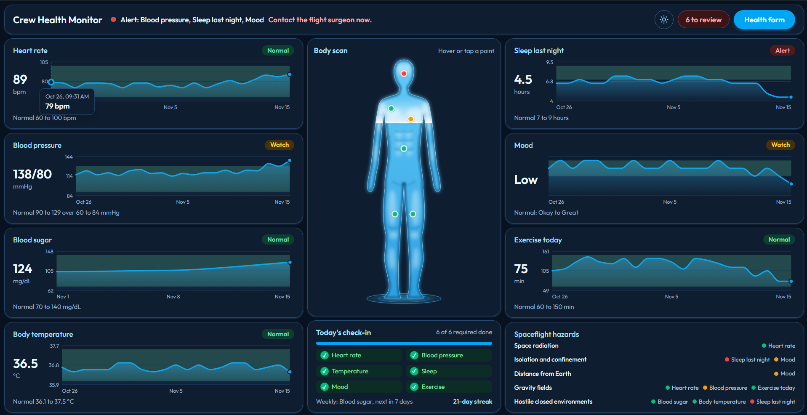

# Crew Health Monitor

Crew Health Monitor is a simple self-check dashboard for astronauts on long-duration missions. It was created for the **NASA Space Apps Challenge 2026** challenge, *“Create Health Monitoring Software for Astronauts on Space Missions.”*



**Try the live demo:** [Open Crew Health Monitor](https://syntaxkavindu.github.io/Space-Health/)

## Why I built it

During a long mission, medical support is far away and communication with Earth may be delayed. That means astronauts need a clear way to notice small changes in their health early.

Radiation, isolation, microgravity and a closed environment can affect the body over time. A few nights of poor sleep, a gradually increasing heart rate or a drop in mood may be easy to overlook on its own. This dashboard brings those signals together, explains them in plain language and suggests what to review next.

## Features

- **At-a-glance health overview:** Track heart rate, blood pressure, blood sugar, temperature, sleep, mood and exercise.
- **Clear status levels:** Each measurement is marked as **Normal**, **Watch** or **Alert**.
- **Interactive charts:** Hover over a chart to see the exact date, time and value. The highlighted band shows the normal range.
- **Interactive body scan:** Explore hotspots for the brain, chest, heart, abdomen and legs to see related readings and spaceflight effects.
- **Guided health form:** Each measurement includes step-by-step instructions and an explanation of why it matters.
- **Alerts and guidance:** Review out-of-range readings and see when it may be time to contact the flight surgeon.
- **Trend warnings:** The app looks for patterns, such as several nights of poor sleep or readings drifting from a personal baseline.
- **Daily check-in:** See which measurements are complete, track weekly blood sugar reminders and maintain a check-in streak.
- **Spaceflight hazards:** Connect NASA’s five human spaceflight hazards to the health indicators they may affect.
- **Responsive themes:** Use the dashboard in light or dark mode on desktop, tablet or mobile.

## Run it locally

You need Node.js 18 or newer.

```bash
git clone https://github.com/SyntaxKavindu/Space-Health
cd Space-Health
npm install
npm run dev
```

Open the local URL shown by Vite in your browser.

## Using the dashboard

1. Open the app. It begins with a simulated 21-day mission so you can explore the dashboard immediately.
2. Refresh the page to generate a different mission scenario: a steady mission, a gradual stress build-up or a possible infection.
3. Use the top bar to check the overall status and see how many items need attention.
4. Hover over the charts and body hotspots to explore the available information.
5. Select **Health form** to enter a new check-in. Use **Instructions** on any field if you need help taking a measurement.

Form entries are kept in memory and disappear when the page is refreshed. This is intentional because the prototype does not use a backend or database.

## Technology

- **React** and **Vite** power the application.
- **Tailwind CSS v4** handles the styling.
- The charts and body scan are built with hand-written SVG; no chart or 3D library is required.
- Everything runs in the browser, which supports the idea of a tool that can remain useful when communication with Earth is slow or unavailable.
- Only the selected theme is saved in `localStorage`.

### Project structure

```text
src/
  App.jsx          page layout, status logic, top bar and alerts panel
  BodyFigure.jsx   body scan and interactive hotspots
  Chart.jsx        interactive area chart with hover tooltip
  MetricCard.jsx   individual health indicator card
  HealthForm.jsx   measurement form
  Instructions.jsx step-by-step measurement help
  data.js          indicators, ranges, advice and hazards
  analysis.js      trends, check-ins and demo mission generation
  theme.js         status colors
```

## Customizing the app

- **Ranges and advice:** update the indicator definitions in `src/data.js`. The `normal` and `caution` values control thresholds, while `low` and `high` contain the related guidance.
- **Demo missions:** update `demoHistory()` in `src/analysis.js` to change the simulated mission scenarios and values.
- **Measurement instructions:** edit the `steps` and `why` fields for an indicator in `src/data.js`.

## Important limitations

This is a prototype, not a medical device.

- The ranges and advice are illustrative and based on general adult reference values.
- The content has not been reviewed or approved by a flight surgeon or other medical professional.
- All readings are simulated or entered manually; no sensors or wearables are connected.
- Check-in data is not saved between sessions. Only the theme preference persists.
- The app has been tested mostly in a desktop browser. Tablet and mobile layouts are supported but may need more testing.

Please do not use this prototype to make medical decisions.

## Possible next steps

- Import data from wearables or CSV files
- Create personal baselines that adapt throughout a mission
- Add full offline support
- Review the thresholds and wording with a space-medicine professional

## Credits

- [NASA Space Apps Challenge](https://www.spaceappschallenge.org/2026/)
- NASA’s Human Research Program for the five spaceflight hazards referenced in the app